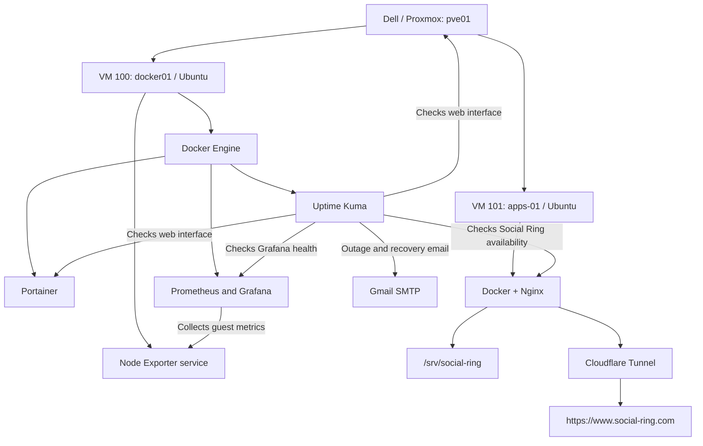

# Hosea Homelab

**Building, operating, and documenting a compact platform for backend applications and distributed systems.**

This repository documents my home lab as it grows from a single Proxmox host into an environment for application deployment, observability, automation, networking, and recovery practice.

My goal is to become a stronger backend engineer by owning the full path from source code to a running service: the infrastructure, network, deployment process, data, monitoring, and operational decisions behind it.

**Current milestone:** Social Ring is publicly hosted from a dedicated Ubuntu Apps VM on the Dell Proxmox host. Nginx serves the static website through Cloudflare Tunnel with HTTPS. Pushes to the source repository trigger a private GitHub Actions deployment workflow, and Portainer manages the Apps VM’s containers. Local availability monitoring and outage/recovery detection have been verified.

**Remote development milestone:** VM `102 (dev01)` now hosts working repositories accessed through VS Code Remote SSH from the Mac. Weekly project backups upload to private AWS S3, exclude every `node_modules` directory, and expire after 35 days. Manual upload and file restore were reported complete; the first scheduled Sunday run remains pending verification.

See [Remote Development and S3 Backups](docs/development-backups.md).

Documentation set:

- [Hardware validation](docs/hardware-validation.md) — Node #1 baseline, Dell diagnostics, and BIOS-record gaps.
- [Current architecture](docs/architecture.md) — physical, virtual, monitoring topology, and public app flow.
- [Build log](docs/build-log.md) — dated milestones and incomplete details.
- [Monitoring and alerting](docs/monitoring.md) — metrics, availability checks, Gmail notifications, and Social Ring validation.
- [Social Ring deployment](docs/social-ring.md) — the public static-site deployment guide for the Apps VM.
- [Remote development and S3 backups](docs/development-backups.md) — the `dev01` workspace, weekly project archives, and restore procedure.
- [Equipment inventory](docs/equipment-inventory.md) — in-service, purchased, and planned hardware.
- [Documentation status](docs/documentation-status.md) — what is documented, partial, planned, or deferred.

**Last updated:** October 25, 2026

## Why I am building this

I work with backend services and cloud infrastructure. This lab gives me a place to build the supporting systems myself, test assumptions, break things deliberately, and document how I recover them.

The long-term objective is a portfolio of working systems and engineering case studies. Installing a tool is a starting point; the useful evidence is deploying an application, explaining its behavior, observing failures, and demonstrating recovery.

The lab must also fit in a one-bedroom apartment, remain affordable to operate, and grow incrementally.

## Current hardware

| Component | Current role |
|---|---|
| Dell OptiPlex 3070 | Primary Proxmox host |
| Intel Core i5-9500, 6 cores | Shared compute for virtual machines |
| 16 GB RAM | Shared host and VM memory |
| 500 GB SATA SSD | Host installation, VM disks, and local snapshots |
| TP-Link Archer AX55 | Lab LAN connectivity and DHCP reservations |
| AT&T gateway | Upstream internet connection |
| Mac | Browser administration and SSH client |

A 2014 Mac mini is available for future experimentation; it is not yet part of the deployed platform.

## What is running today

| Layer | Verified configuration |
|---|---|
| Hypervisor | Proxmox VE on node `pve01` |
| First VM | `docker01`, VM ID `100` |
| Guest OS | Ubuntu Server 24.04.5 LTS |
| VM resources | 2 vCPU, 4 GiB RAM, 64 GiB virtual disk |
| Guest networking | VirtIO interface bridged through `vmbr0`; DHCP reservation configured |
| Administration | SSH access from the Mac; Proxmox and Portainer web interfaces |
| Guest integration | QEMU guest agent installed and confirmed active |
| Container platform | Docker Engine and Docker Compose plugin installed |
| Management UI | Portainer CE connected to the local Docker environment |
| Resource monitoring | Node Exporter, Prometheus, and Grafana; Node Exporter Full dashboard |
| Availability monitoring | Uptime Kuma with checks for Proxmox, Portainer, Grafana, and the local Social Ring availability check |
| Notifications | Gmail SMTP; test message and Grafana outage/recovery emails confirmed |
| Public app VM | `apps-01`, VM ID `101`; Ubuntu Server 24.04.5 LTS, 2 vCPU, 2 GiB RAM, 32 GiB virtual disk |
| Public app runtime | Nginx serves static content from `/srv/social-ring` |
| Public access | Cloudflare Tunnel terminates HTTPS at `https://www.social-ring.com` and `https://lab.social-ring.com` |
| Delivery automation | Private GitHub Actions workflow deploys website updates from the public source repository |

The Docker `hello-world` container completed with exit code `0`. Portainer is running and can list the local containers. The primary public deployment in the current lab is a static Social Ring site served from the dedicated Apps VM, not a backend application with database migrations or Kubernetes.

## Completed foundation and monitoring

- [x] Install Proxmox on the Dell.
- [x] Configure the Proxmox management network.
- [x] Configure the no-subscription package repository for lab use and apply host updates.
- [x] Create the first Ubuntu Server VM.
- [x] Install Ubuntu and apply guest updates.
- [x] Verify SSH access over the local network.
- [x] Install and verify the QEMU guest agent.
- [x] Reserve the VM's DHCP address on the router.
- [x] Install Docker Engine and the Compose plugin.
- [x] Run the Docker `hello-world` test successfully.
- [x] Deploy Portainer and complete administrator setup.
- [x] Verify Portainer can manage the local Docker environment.
- [x] Create `ubuntu-base` and `docker-portainer-ready` recovery snapshots.
- [x] Install Node Exporter and verify successful Prometheus scrapes.
- [x] Connect Grafana and import Node Exporter Full, dashboard ID `1860`.
- [x] Deploy Uptime Kuma with SQLite and persistent storage.
- [x] Add HTTP checks for Proxmox, Portainer, and Grafana.
- [x] Verify Grafana outage detection and recovery.
- [x] Configure Gmail and confirm DOWN and UP emails.
- [x] Create the `monitoring-ready` snapshot with RAM excluded.
- [x] Create VM `101`, hostname `apps-01`, on Ubuntu Server 24.04.5 LTS with 2 vCPU, 2 GiB RAM, and 32 GiB disk.
- [x] Install Docker and Docker Compose on `apps-01` and confirm the VM starts automatically through Proxmox with a DHCP reservation.
- [x] Connect `apps-01` to Portainer Agent and serve the Social Ring static site through Nginx from `/srv/social-ring`.
- [x] Confirm a local availability HTTP check at `http://<APPS_VM_IP>:8080` and validate a controlled outage/recovery test.
- [x] Deploy the self-hosted GitHub Actions runner as `github-runner` with permission to update website files without sudo or Docker access.
- [x] Confirm the private deployment workflow publishes the static website and the Cloudflare Tunnel serves the site over HTTPS.
- [x] Save the pre-deploy snapshot before the GitHub-driven change set was applied.

Snapshots live on the host’s storage and provide rollback points rather than independent backups. Development project files now have off-site S3 backups and a user-reported file restore test. Full VM backups and VM restore testing remain deferred. Project archives do not capture live application databases, uploads outside the project directory, or Docker volumes.

## Service access

Replace `<VM_IP>` with the reserved LAN address of `docker01` and `<PROXMOX_IP>` with the management address of `pve01`. These are templates for local access, not public URLs. Keep actual bookmarks in private notes.

| Service | Local URL template | Purpose |
|---|---|---|
| Social Ring | `http://<APPS_VM_IP>:8080` | Local HTTP availability check for the public static site |
| Uptime Kuma | `http://<VM_IP>:3001/dashboard` | Availability, response times, and outage history |
| Grafana | `http://<VM_IP>:3000/dashboards` | Guest resource dashboards |
| Prometheus | `http://<VM_IP>:9090/targets` | Scrape target health |
| Portainer | `https://<VM_IP>:9443/` | Container administration |
| Proxmox | `https://<PROXMOX_IP>:8006/` | VM administration and snapshots |

The Portainer and Proxmox links use their base URLs so they do not depend on a particular screen or browser fragment.

## Roadmap

The table separates completed work from planned expansion. Resource allocations and placement will be revisited as the lab grows; the current 16 GB host is not intended to run every listed technology at once.

| Phase | Build | Evidence of completion |
|---|---|---|
| 1 — Foundation | Proxmox, Ubuntu, Docker, Portainer | Working VM, SSH access, successful container test, recovery snapshots. **Complete.** |
| 2 — Monitoring | Node Exporter, Prometheus, Grafana, Uptime Kuma, Gmail | **Guest metrics, three availability checks, and email alerts complete.** Physical host metrics and independent outage monitoring remain planned. |
| 3 — Static public hosting | Public website on the Apps VM, Nginx, Cloudflare Tunnel, HTTPS | **Static website is live through Cloudflare, auto-deployed from GitHub, and local availability is confirmed.** Root-domain redirect, clean URLs, and public HTTPS monitoring remain pending verification. |
| 4 — Backend service | A Java/Spring Boot API with PostgreSQL; Redis where justified | Repeatable deployment, health checks, persisted data, API tests, and documented design choices. |
| 5 — Delivery automation | Git-based configuration and a CI runner; evaluate GitLab Runner or Jenkins | **Private GitHub deployment workflow is operating for the website.** Backend build pipelines, security checks, and broader CI orchestration remain planned. |
| 6 — Kubernetes | A small k3s environment | Deploy the API with service discovery, configuration, probes, and persistent storage; compare the tradeoffs with Compose. |
| 7 — Distributed systems | Messaging and asynchronous processing; evaluate Kafka | A documented event flow demonstrating retries, duplicate handling, and failure recovery. |
| 8 — Recovery and access | Independent backups, restore drills, private remote access, secrets management | Backups and restore testing deferred until NAS acquisition. Remaining access work is planned. |
| 9 — Personal services | Selected media, file-transfer, backup, and website workloads | A service with storage, access, monitoring, and recovery requirements documented before regular use. |

Initial guest monitoring and service alerts are running. A longer baseline will help evaluate later workloads. Server resource monitoring and whole-home internet monitoring are separate concerns: bandwidth, latency, and router visibility will need their own measurements.

## Engineering exercises

Each substantial addition should answer a practical question and produce something reviewable.

| Exercise | What I want to demonstrate |
|---|---|
| Trace a request from client to API to database | Understand routing, ports, DNS, application behavior, and data access. |
| Stop an application container | Detect the failure, inspect logs, and verify recovery behavior. |
| Reboot a VM | Verify service startup and persistence after restart. |
| Restore a backup into an isolated environment | Prove recovery works without risking the active service. |
| Apply controlled load | Measure latency, throughput, CPU, memory, and the first bottleneck. |
| Roll back a failed release | Restore a known version and explain database compatibility constraints. |
| Move a service from Compose to k3s | Compare operational cost and benefits using the same workload. |

Load and failure experiments will be scoped to lab workloads with clear stop conditions, particularly while the lab shares the household internet connection.

## Repository organization

The documentation now covers the current architecture, the initial hardware-validation/build history, monitoring, equipment status, and explicit documentation gaps. Configuration-as-code and operational runbooks remain future additions.

| Path | Purpose | Status |
|---|---|---|
| `docs/hardware-validation.md` | Node #1 hardware baseline, diagnostics, and BIOS-record gaps | Added |
| `docs/architecture.md` | Current topology, responsibilities, failure domains, and resource allocation | Added |
| `docs/build-log.md` | Dated setup milestones and validation results | Added |
| `docs/monitoring.md` | Monitoring setup, service checks, alert validation, and recovery notes | Existing |
| `docs/social-ring.md` | Detailed Social Ring deployment, delivery automation, operations, and limits | Added |
| `docs/development-backups.md` | Remote development VM, S3 project backups, and restore procedure | Added |
| `docs/equipment-inventory.md` | Deployed, purchased, and planned physical equipment | Added |
| `docs/documentation-status.md` | Audit of documented, partial, planned, and deferred work | Added |
| `docs/decisions/` | Short records of meaningful technical decisions | Planned |
| `docs/runbooks/` | Deployment, update, troubleshooting, and recovery procedures | Planned |
| `docs/incidents/` | Failure observations, causes, fixes, and follow-up work | Planned |
| `infra/` | Infrastructure configuration and automation added over time | Planned |
| `services/` | Reviewed Compose manifests and service configuration examples | Planned |
| `services/social-ring/` | Sanitized Nginx and Compose examples for the public static site | Added as examples pending live comparison |
| `monitoring/` | Dashboard definitions, scrape configuration, and alert rules | Planned |
| `apps/` | Backend application code or links to separate application repositories | Planned |

## Documentation standards

For each project, I will record:

1. The problem and intended behavior.
2. The architecture and relevant constraints.
3. The configuration needed to reproduce the deployment.
4. Validation results, including failures and their resolution.
5. Monitoring, backup, and rollback considerations.
6. What I learned and what I would change next.

Public documentation will use sanitized examples. Passwords, setup tokens, private keys, recovery codes, and real `.env` files do not belong in the repository. Screenshots will be reviewed for unrelated personal information before publishing.

## Future physical expansion

Potential additions include a compact rack, UPS, managed switch, NAS, and a second compute node. Purchases will follow demonstrated requirements such as memory pressure, storage capacity, backup needs, power protection, or network isolation.

The objective is a useful, understood system rather than a fixed hardware shopping list.

## Success criteria

The lab is serving its larger goal when I can:

- Explain how a request reaches a service and where it can fail.
- Deploy a backend application from version-controlled configuration.
- Use metrics and logs to investigate behavior instead of guessing.
- Recover a service and its data from a tested backup.
- Measure performance and describe the limits of the measurements.
- Explain the tradeoffs behind the infrastructure I chose.
- Publish clear case studies supported by actual configuration and results.

Selected write-ups can later be published on [hoseacodes.com](https://hoseacodes.com), with this repository holding the supporting technical work.

## Reference documentation

- [Proxmox VE documentation](https://pve.proxmox.com/pve-docs/)
- [Ubuntu Server documentation](https://documentation.ubuntu.com/server/)
- [Docker Engine installation on Ubuntu](https://docs.docker.com/engine/install/ubuntu/)
- [Portainer CE installation on Docker](https://docs.portainer.io/start/install-ce/server/docker/linux)
- [Uptime Kuma](https://github.com/louislam/uptime-kuma)
- [Prometheus documentation](https://prometheus.io/docs/)
- [Grafana documentation](https://grafana.com/docs/grafana/latest/)

---

Maintained by Dominique Hosea. This is an evolving learning environment; completed milestones reflect verified work, and the roadmap will change as experiments reveal new requirements.
