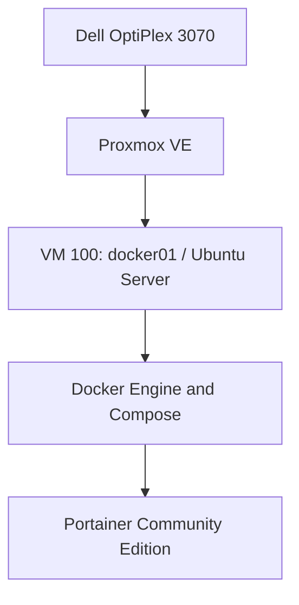

# Homelab

**Building, operating, and documenting a compact platform for backend applications and distributed systems.**

This repository documents my home lab as it grows from a single Proxmox host into an environment for application deployment, observability, automation, networking, and recovery practice.

My goal is to become a stronger backend engineer by owning the full path from source code to a running service: the infrastructure, network, deployment process, data, monitoring, and operational decisions behind it.

**Current milestone:** Ubuntu Server, Docker, and Portainer are running in the first VM. A recovery snapshot has been created after setup.

**Last updated:** October 23, 2026

## Why I am building this

I work with backend services and cloud infrastructure. This lab gives me a place to build the supporting systems myself, test assumptions, break things deliberately, and document how I recover them.

The long-term objective is a portfolio of working systems and engineering case studies. Installing a tool is a starting point; the useful evidence is deploying an application, explaining its behavior, observing failures, and demonstrating recovery.

The lab must also fit in a one-bedroom apartment, remain affordable to operate, and grow incrementally.

## Current hardware

| Component | Current role |
|---|---|
| Dell OptiPlex 3070 | Primary Proxmox host |
| Intel Core i5-9500, 6 cores | Shared compute for virtual machines |
| 16 GB RAM | Shared host and VM memory |
| 500 GB SATA SSD | Host installation, VM disks, and local snapshots |
| TP-Link Archer AX55 | Lab LAN connectivity and DHCP reservations |
| AT&T gateway | Upstream internet connection |
| Mac | Browser administration and SSH client |

A 2014 Mac mini is available for future experimentation; it is not yet part of the deployed platform.

## What is running today

| Layer | Verified configuration |
|---|---|
| Hypervisor | Proxmox VE on node `pve01` |
| First VM | `docker01`, VM ID `100` |
| Guest OS | Ubuntu Server 24.04.5 LTS |
| VM resources | 2 vCPU, 4 GiB RAM, 64 GiB virtual disk |
| Guest networking | VirtIO interface bridged through `vmbr0`; DHCP reservation configured |
| Administration | SSH access from the Mac; Proxmox and Portainer web interfaces |
| Guest integration | QEMU guest agent installed and confirmed active |
| Container platform | Docker Engine and Docker Compose plugin installed |
| Management UI | Portainer CE connected to the local Docker environment |

The Docker `hello-world` container completed with exit code `0`. Portainer is running and can list the local containers. No public application has been deployed through this lab yet.

## Completed foundation

- [x] Install Proxmox on the Dell.
- [x] Configure the Proxmox management network.
- [x] Configure the no-subscription package repository for lab use and apply host updates.
- [x] Create the first Ubuntu Server VM.
- [x] Install Ubuntu and apply guest updates.
- [x] Verify SSH access over the local network.
- [x] Install and verify the QEMU guest agent.
- [x] Reserve the VM's DHCP address on the router.
- [x] Install Docker Engine and the Compose plugin.
- [x] Run the Docker `hello-world` test successfully.
- [x] Deploy Portainer and complete administrator setup.
- [x] Verify Portainer can manage the local Docker environment.
- [x] Create `ubuntu-base` and `docker-portainer-ready` recovery snapshots.

Snapshots currently live on the host's storage. They provide rollback points, but they are not independent backups and do not protect against host disk failure.

## Roadmap

These phases describe planned work, not completed deployments. Resource allocations and placement will be revisited as the lab grows; the current 16 GB host is not intended to run every listed technology at once.

| Phase | Build | Evidence of completion |
|---|---|---|
| 1 — Foundation | Proxmox, Ubuntu, Docker, Portainer | Working VM, SSH access, successful container test, recovery snapshots. **Complete.** |
| 2 — Monitoring | Prometheus, Grafana, relevant exporters, availability checks | Dashboards for host/guest resources and service health; one tested alert. |
| 3 — Backend service | A Java/Spring Boot API with PostgreSQL; Redis where justified | Repeatable deployment, health checks, persisted data, API tests, and documented design choices. |
| 4 — Delivery automation | Git-based configuration and a CI runner; evaluate GitLab Runner or Jenkins | A commit triggers tests, builds a versioned image, and deploys it with a documented rollback path. |
| 5 — Kubernetes | A small k3s environment | Deploy the API with service discovery, configuration, probes, and persistent storage; compare the tradeoffs with Compose. |
| 6 — Distributed systems | Messaging and asynchronous processing; evaluate Kafka | A documented event flow demonstrating retries, duplicate handling, and failure recovery. |
| 7 — Recovery and access | Independent backups, restore drills, private remote access, secrets management | A successful restore with measured recovery time and documented access controls. |
| 8 — Personal services | Selected media, file-transfer, backup, and website workloads | A service with storage, access, monitoring, and recovery requirements documented before regular use. |

Monitoring comes next so later workloads can be evaluated against a baseline. Server resource monitoring and whole-home internet monitoring are separate concerns: bandwidth, latency, and router visibility will need their own measurements.

## Engineering exercises

Each substantial addition should answer a practical question and produce something reviewable.

| Exercise | What I want to demonstrate |
|---|---|
| Trace a request from client to API to database | Understand routing, ports, DNS, application behavior, and data access. |
| Stop an application container | Detect the failure, inspect logs, and verify recovery behavior. |
| Reboot a VM | Verify service startup and persistence after restart. |
| Restore a backup into an isolated environment | Prove recovery works without risking the active service. |
| Apply controlled load | Measure latency, throughput, CPU, memory, and the first bottleneck. |
| Roll back a failed release | Restore a known version and explain database compatibility constraints. |
| Move a service from Compose to k3s | Compare operational cost and benefits using the same workload. |

Load and failure experiments will be scoped to lab workloads with clear stop conditions, particularly while the lab shares the household internet connection.

## Repository organization

The README is the first deliverable. The following paths are a proposed structure to add as the corresponding work is completed; they are not existing implementations.

| Planned path | Purpose |
|---|---|
| `docs/architecture.md` | Current topology, responsibilities, and resource allocation |
| `docs/build-log.md` | Dated setup milestones and validation results |
| `docs/decisions/` | Short records of meaningful technical decisions |
| `docs/runbooks/` | Deployment, update, troubleshooting, and recovery procedures |
| `docs/incidents/` | Failure observations, causes, fixes, and follow-up work |
| `infra/` | Infrastructure configuration and automation added over time |
| `services/` | Reviewed Compose manifests and service configuration examples |
| `monitoring/` | Dashboard definitions, scrape configuration, and alert rules |
| `apps/` | Backend application code or links to separate application repositories |

## Documentation standards

For each project, I will record:

1. The problem and intended behavior.
2. The architecture and relevant constraints.
3. The configuration needed to reproduce the deployment.
4. Validation results, including failures and their resolution.
5. Monitoring, backup, and rollback considerations.
6. What I learned and what I would change next.

Public documentation will use sanitized examples. Passwords, setup tokens, private keys, recovery codes, and real `.env` files do not belong in the repository. Screenshots will be reviewed for unrelated personal information before publishing.

## Future physical expansion

Potential additions include a compact rack, UPS, managed switch, NAS, and a second compute node. Purchases will follow demonstrated requirements such as memory pressure, storage capacity, backup needs, power protection, or network isolation.

The objective is a useful, understood system rather than a fixed hardware shopping list.

## Success criteria

The lab is serving its larger goal when I can:

- Explain how a request reaches a service and where it can fail.
- Deploy a backend application from version-controlled configuration.
- Use metrics and logs to investigate behavior instead of guessing.
- Recover a service and its data from a tested backup.
- Measure performance and describe the limits of the measurements.
- Explain the tradeoffs behind the infrastructure I chose.
- Publish clear case studies supported by actual configuration and results.

Selected write-ups can later be published on [hoseacodes.com](https://hoseacodes.com), with this repository holding the supporting technical work.

## Reference documentation

- [Proxmox VE documentation](https://pve.proxmox.com/pve-docs/)
- [Ubuntu Server documentation](https://documentation.ubuntu.com/server/)
- [Docker Engine installation on Ubuntu](https://docs.docker.com/engine/install/ubuntu/)
- [Portainer CE installation on Docker](https://docs.portainer.io/start/install-ce/server/docker/linux)

---

Maintained by Dominique Hosea. This is an evolving learning environment; completed milestones reflect verified work, and the roadmap will change as experiments reveal new requirements.
