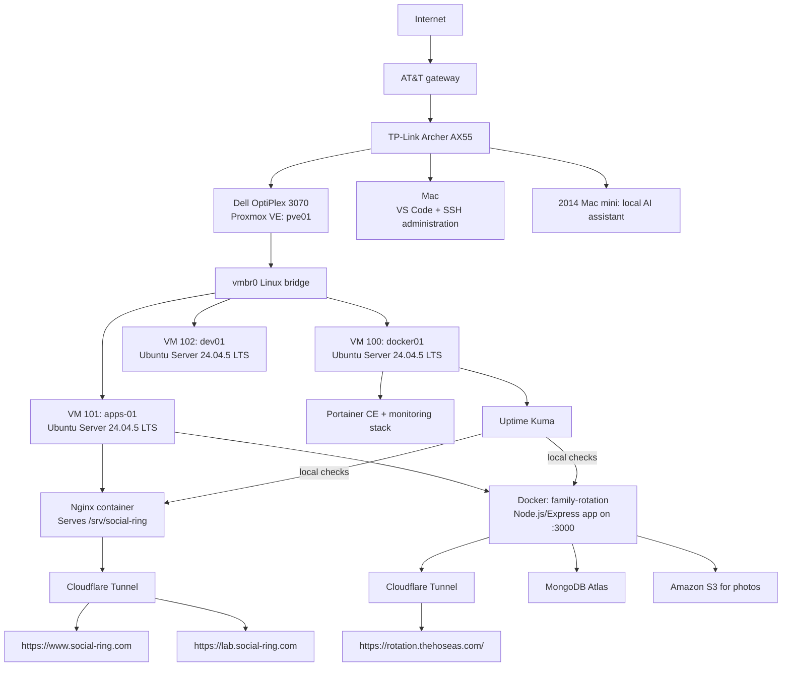
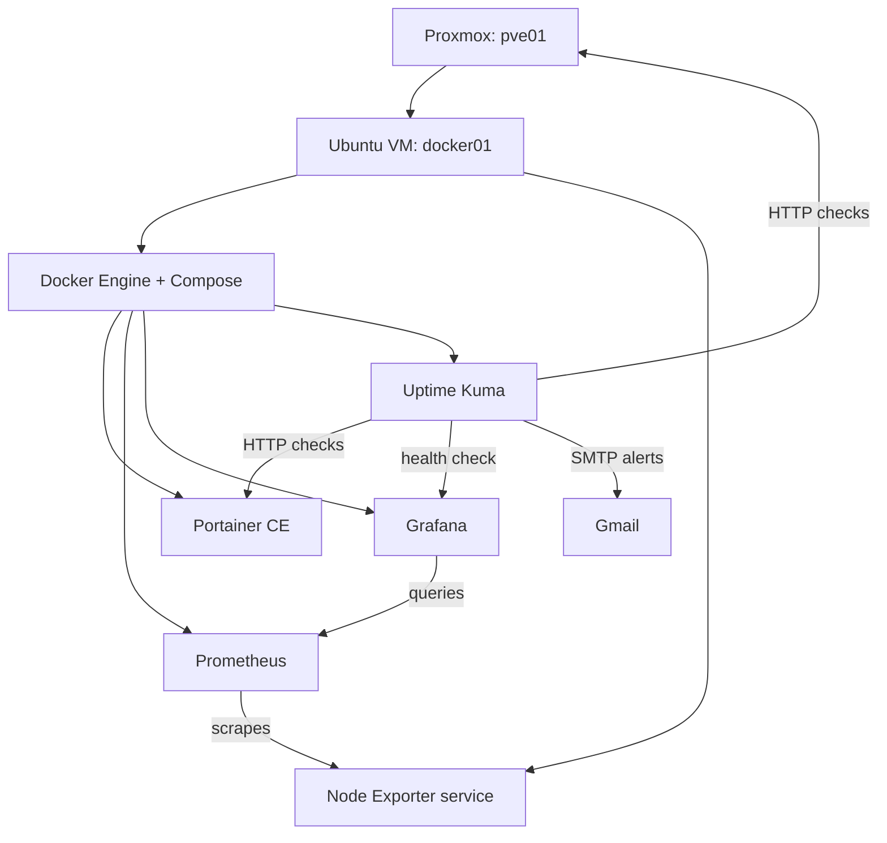
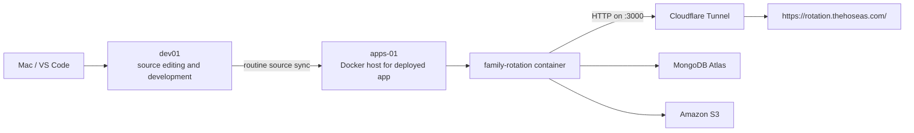

# HomeLab Architecture — Current State

**Recorded:** November 15, 2026

**Status:** Reflects the verified Proxmox lab, the public Social Ring deployment, the Family Rotation deployment on the Apps VM, and a separate Mac mini local AI assistant. This document distinguishes verified runtime facts from work still pending verification.

This document describes what is running today. Planned equipment and services are separated from deployed components so the architecture does not overstate the current lab.

## Current physical and network topology

The Archer AX55 provides the LAN connectivity used by the current lab and holds the DHCP reservation for `docker01`. The Proxmox management interface and the Ubuntu guest are reachable only on the local/private network unless a later remote-access design explicitly exposes or tunnels them.

## Node #1

| Resource | Current configuration |
|---|---|
| Physical host | Dell OptiPlex 3070 |
| Hypervisor | Proxmox VE |
| Proxmox node name | `pve01` |
| CPU | Intel Core i5-9500, 6 cores |
| RAM | 16 GB |
| Local storage | Crucial MX500 500 GB SATA SSD |
| Management network | Proxmox management network configured through the LAN |
| Package source | No-subscription repository configured for lab use |
| Host updates | Applied after initial installation |

## First workload VM

| Resource | Current configuration |
|---|---|
| VM ID | `100` |
| Hostname | `docker01` |
| Guest OS | Ubuntu Server 24.04.5 LTS |
| vCPU | 2 |
| RAM | 4 GiB |
| Virtual disk | 64 GiB |
| NIC | VirtIO |
| Network path | Guest NIC → `vmbr0` → Archer LAN |
| Addressing | Router DHCP reservation |
| Administration | SSH from the Mac |
| Guest integration | QEMU guest agent installed and active |

## Apps VM for the public website

| Resource | Current configuration |
|---|---|
| VM ID | `101` |
| Hostname | `apps-01` |
| Guest OS | Ubuntu Server 24.04.5 LTS |
| vCPU | 2 |
| RAM | 2 GiB |
| Virtual disk | 32 GiB |
| NIC | VirtIO |
| Network path | Guest NIC → `vmbr0` → Archer LAN |
| Addressing | Router DHCP reservation |
| Administration | SSH from the Mac and Portainer Agent connection |
| Public site path | `/srv/social-ring` |
| Runtime | Nginx container serving static site files |
| Access path | Local HTTP on `http://<APPS_VM_IP>:8080` |
| Public access | Cloudflare Tunnel with HTTPS at `https://www.social-ring.com` and `https://lab.social-ring.com` |
| Automation | Self-hosted GitHub Action runner runs as `github-runner` and updates website files without sudo or Docker access |

## Application and monitoring architecture

### Current services

| Service | Purpose | Current state |
|---|---|---|
| Docker Engine | Container runtime | Running on `docker01` and `apps-01` |
| Docker Compose plugin | Multi-container/declarative workflow | Installed on both VMs |
| Portainer CE | Local Docker administration | Running and verified on `docker01` |
| Portainer Agent | Remote container management for `apps-01` | Connected to the same Portainer instance |
| Node Exporter | Ubuntu guest metrics | Running as a system service on `docker01` |
| Prometheus | Metrics collection/storage | Running; self and guest targets verified `UP` |
| Grafana | Metrics dashboards | Running with Node Exporter Full dashboard ID `1860` |
| Uptime Kuma | Service availability checks | Running with persistent SQLite storage |
| Nginx | Static site hosting from `/srv/social-ring` | Serving the public site on `apps-01` |
| Cloudflare Tunnel | Public HTTPS exposure | Connected to the static site; no router port forwarding required |
| GitHub runner | Private deployment automation | Running as `github-runner`; writes website files without sudo or Docker access |
| Gmail SMTP | Alert delivery | Test message and Grafana DOWN/UP alerts verified |

## Public deployment path

The current public website request path is intentionally simple and local to the lab design:

1. A push to the public source repository triggers the private deployment workflow.
2. The workflow downloads the static site assets and publishes them to `/srv/social-ring` on `apps-01`.
3. Nginx serves those files on the local app VM port `8080`.
4. Cloudflare Tunnel exposes the site over HTTPS without router port forwarding.
5. Uptime Kuma checks the local HTTP endpoint to confirm the site is up before wider public access is considered stable.

This is a static site workflow, not a backend service with database migrations or a Kubernetes rollout. The deployment automation is complete for the site’s current scope.

## Family Rotation deployment (verified November 15, 2026)

Family Rotation is a separate application from Social Ring and is not part of the static-site deployment flow. The runtime is hosted from the home lab on `apps-01`, with a manually managed Docker deployment and Cloudflare Tunnel routing to the public hostname.

### Architecture

### Operational boundaries

- `dev01` is the development workspace and source control/working copy location.
- `apps-01` is the deployment host and runs the app container independently of the Mac and `dev01`.
- The Mac is the interface used for editing and administrative work; it is not required for the deployed app to keep running.
- The Dell Proxmox host, `apps-01`, Docker, Cloudflare Tunnel, the home power/internet connection, and the external Atlas/S3 services are all part of the runtime dependency chain.
- Social Ring remains a separate app and is served on port `8080`; it is not the Family Rotation runtime.
- The prior Fly.io deployment was discussed during migration, but no verified documentation confirms Fly.io resources or billing were removed.

### Verified facts

- Physical host: `pve01` on the existing Dell Proxmox server.
- Development VM: `dev01`, current IP `192.168.0.245`.
- Development source: `/home/dominique/projects/familyRotation`.
- Application VM: `apps-01`, IP `192.168.0.47`.
- Deployment source: `/home/dominique/deployments/familyRotation`.
- Runtime: Node.js/Express service serving frontend and API.
- Docker image: `family-rotation:local` built from the existing Dockerfile.
- Container: `family-rotation` with a `restart: unless-stopped` policy.
- Published port: `192.168.0.47:3000:3000`.
- Runtime config: `NODE_ENV=production`, `PORT=3000`, `DATA_DIR=/app/data` in the deployment `.env`, with file permissions `600`.
- Data volume: `family-rotation-data` mounted at `/app/data`.
- Public URL: `https://rotation.thehoseas.com/`.
- Public access was reported working through the existing Cloudflare Tunnel to `192.168.0.47:3000`.
- Health endpoint: `/api/health` returned HTTP `200` with `ok: true`, `storageMode: "mongo"`, `database: "connected"`, and `photoStorage: "s3"`.
- Application data is stored in MongoDB Atlas and photos in Amazon S3.

### Pending verification and follow-up

- Automatic deployment workflow check is still pending.
- A confirmed GitHub remote is not documented for this application.
- Backup and restore verification for Atlas, S3, and the app VM remain pending.
- Container rollback testing remains pending.
- Runtime upgrade for the Node 20/AWS SDK warning remains follow-up work.

## Recovery checkpoints

| Snapshot | Captured state |
|---|---|
| `ubuntu-base` | Updated Ubuntu, SSH, QEMU guest agent, DHCP reservation; before Docker |
| `docker-portainer-ready` | Docker verified and Portainer working; before monitoring |
| `monitoring-ready` | Metrics, uptime checks, and tested Gmail notifications; RAM excluded |
| `apps-before-github-deploy` | Confirmed before the private GitHub deployment flow published the Social Ring site |

These are local snapshots on the same physical storage. They are rollback points, not independent backups.

## Development VM and off-site project backup

VM `102 (dev01)` provides a dedicated Ubuntu development workspace. VS Code runs on the Mac and connects through Remote SSH; repositories and development tools live under `/home/dominique/projects`.

The VM uses 2 virtual cores, an 80 GB virtual disk, and VirtIO networking through `vmbr0`. Its memory target is 4 GiB; final RAM allocation, root filesystem capacity, and DHCP reservation still need verification.

The Social Ring working copy is separate from the deployment runner checkout and production website files on `apps-01`.

Weekly project archives upload to private S3 storage independently of the Dell’s disk. Every `node_modules` directory is excluded and the archive listing is checked before upload. Archives expire after 35 days.

The schedule depends on `dev01` being powered on and connected to the internet. Failures are logged without notifications. Full VM and live application data recovery remain separate work.

See [Remote Development and S3 Backups](development-backups.md).

## Separate local AI host

The 2014 Mac mini runs macOS Monterey 12.7.6 on Intel x86_64 with 8 GB RAM and an approximately 1 TB HDD. It is a physical host outside Proxmox, with no cluster or high-availability role.

- iPhone Safari accesses the Flask/Waitress frontend over LAN HTTP on port `8082`.
- The frontend retrieves up to three matching Markdown passages from a local clone of this repository and calls llama.cpp on `127.0.0.1:8081`.
- Qwen2.5-1.5B-Instruct Q4_K_M runs locally on CPU with a 2,048-token context and two inference threads. No cloud inference API is configured.
- System LaunchDaemons supervise the model and frontend under the Mac account. A browser request and a fresh document answer worked after reboot without manually starting either process.
- The assistant has no live service checks, command execution, or infrastructure credentials. Retrieval is lexical search, not model training or a vector database.
- A router DHCP reservation was reported configured on October 31. It applies to one interface’s MAC address, so Wi-Fi and Ethernet need separate reservations; SSH and the assistant address must be retested after the planned relocation.

See [Local AI assistant](local-ai-assistant.md) for configuration, validation, and operations. The frontend currently has no authentication or TLS; no public exposure or VPN setup is claimed.

## Current failure domains

The current design intentionally prioritizes learning and low apartment footprint over high availability.

- `pve01` is a single physical host. Host or SSD failure removes all VMs and their services. The separate Mac mini remains a distinct compute failure domain.
- Prometheus, Grafana, Portainer, and Uptime Kuma all depend on `docker01`.
- Uptime Kuma cannot independently report a total failure of the host it runs on.
- The AI frontend and model share the Mac mini and its HDD. Neither AI service is yet covered by the existing monitoring stack; no assistant backup/restore test is recorded.
- The assistant uses a manually refreshed document clone, so answers may lag repository changes and do not establish live infrastructure state.
- Gmail alerts depend on outbound internet access.
- No NAS-backed or off-host VM backup has been completed.
- Development project file restore was reported complete. Full VM and live application recovery have not been tested.

## Public deployment notes and remaining uncertainty

The verified deployment includes the public static site, the local site endpoint, and the Cloudflare HTTPS exposure. The following behaviors are explicitly not yet confirmed as complete and are intentionally described as pending verification:

- Root-domain redirect and canonical host enforcement.
- Always Use HTTPS enforcement.
- Clean URLs without `.html` suffixes.
- Public HTTPS monitoring via Uptime Kuma or a similar external check.
- Rollback execution and recovery testing for the Nginx or workflow configuration.

## Planned physical expansion — not yet part of the running architecture

- Compact 8U RackMate rack integration
- Managed Ethernet switch
- UPS/power protection
- NAS for independent backups and shared storage
- Additional compute node(s)
- Dedicated firewall/VPN appliance if the lab requirements justify it
- Optional dashboard/display

These are requirements-driven additions, not a fixed shopping checklist.

## Planned platform expansion — not yet deployed

- Java/Spring Boot backend service
- PostgreSQL and Redis where justified by the workload
- CI runner / delivery automation
- k3s Kubernetes environment
- Messaging/event-driven experiment such as Kafka
- Secrets management such as Vault
- Independent backup/restore workflow
- Private remote access
- Selected personal media/file-transfer/self-hosted services
