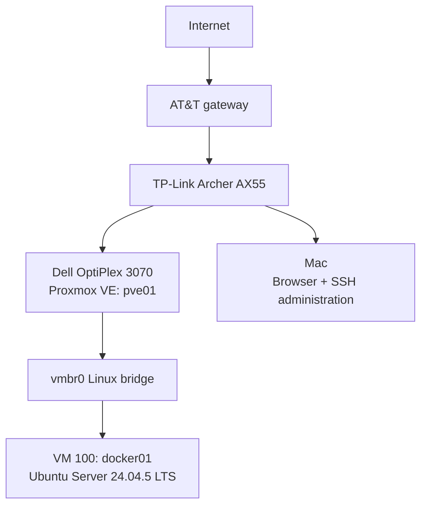
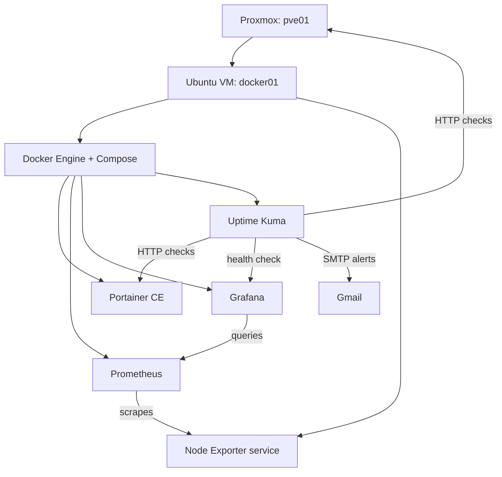

# HomeLab Architecture — Current State

**Recorded:** October 24, 2026  
**Status:** Reflects the currently verified single-host Proxmox lab and monitoring stack.

This document describes what is running today. Planned equipment and services are separated from deployed components so the architecture does not overstate the current lab.

## Current physical and network topology

The Archer AX55 provides the LAN connectivity used by the current lab and holds the DHCP reservation for `docker01`. The Proxmox management interface and the Ubuntu guest are reachable only on the local/private network unless a later remote-access design explicitly exposes or tunnels them.

## Node #1

| Resource | Current configuration |
|---|---|
| Physical host | Dell OptiPlex 3070 |
| Hypervisor | Proxmox VE |
| Proxmox node name | `pve01` |
| CPU | Intel Core i5-9500, 6 cores |
| RAM | 16 GB |
| Local storage | Crucial MX500 500 GB SATA SSD |
| Management network | Proxmox management network configured through the LAN |
| Package source | No-subscription repository configured for lab use |
| Host updates | Applied after initial installation |

## First workload VM

| Resource | Current configuration |
|---|---|
| VM ID | `100` |
| Hostname | `docker01` |
| Guest OS | Ubuntu Server 24.04.5 LTS |
| vCPU | 2 |
| RAM | 4 GiB |
| Virtual disk | 64 GiB |
| NIC | VirtIO |
| Network path | Guest NIC → `vmbr0` → Archer LAN |
| Addressing | Router DHCP reservation |
| Administration | SSH from the Mac |
| Guest integration | QEMU guest agent installed and active |

## Application and monitoring architecture

### Current services

| Service | Purpose | Current state |
|---|---|---|
| Docker Engine | Container runtime | Running on `docker01` |
| Docker Compose plugin | Multi-container/declarative workflow | Installed |
| Portainer CE | Local Docker administration | Running and verified |
| Node Exporter | Ubuntu guest metrics | Running as a system service |
| Prometheus | Metrics collection/storage | Running; self and guest targets verified `UP` |
| Grafana | Metrics dashboards | Running with Node Exporter Full dashboard ID `1860` |
| Uptime Kuma | Service availability checks | Running with persistent SQLite storage |
| Gmail SMTP | Alert delivery | Test message and Grafana DOWN/UP alerts verified |

## Recovery checkpoints

| Snapshot | Captured state |
|---|---|
| `ubuntu-base` | Updated Ubuntu, SSH, QEMU guest agent, DHCP reservation; before Docker |
| `docker-portainer-ready` | Docker verified and Portainer working; before monitoring |
| `monitoring-ready` | Metrics, uptime checks, and tested Gmail notifications; RAM excluded |

These are local snapshots on the same physical storage. They are rollback points, not independent backups.

## Current failure domains

The current design intentionally prioritizes learning and low apartment footprint over high availability.

- `pve01` is a single physical host. Host or SSD failure removes the VM and all services.
- Prometheus, Grafana, Portainer, and Uptime Kuma all depend on `docker01`.
- Uptime Kuma cannot independently report a total failure of the host it runs on.
- Gmail alerts depend on outbound internet access.
- No NAS-backed or off-host VM backup has been completed.
- No restore drill has been completed.

## Planned physical expansion — not yet part of the running architecture

- Compact 8U RackMate rack integration
- Managed Ethernet switch
- UPS/power protection
- NAS for independent backups and shared storage
- Additional compute node(s)
- Dedicated firewall/VPN appliance if the lab requirements justify it
- Optional dashboard/display

These are requirements-driven additions, not a fixed shopping checklist.

## Planned platform expansion — not yet deployed

- Java/Spring Boot backend service
- PostgreSQL and Redis where justified by the workload
- CI runner / delivery automation
- k3s Kubernetes environment
- Messaging/event-driven experiment such as Kafka
- Secrets management such as Vault
- Independent backup/restore workflow
- Private remote access
- Selected personal media/file-transfer/self-hosted services
