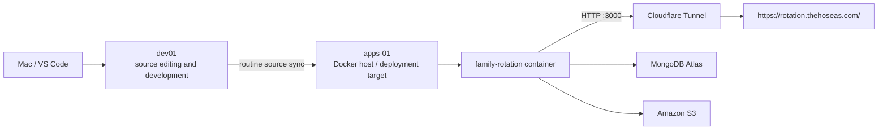

# Family Rotation Deployment

**Recorded:** November 15, 2026

**Status:** Verified runtime state for the current home-hosted deployment. This document separates confirmed runtime facts from follow-up work and pending verification.

This is a separate application from Social Ring. The deployed app runs on the HomeLab Apps VM, is exposed through Cloudflare Tunnel, and relies on external MongoDB Atlas and Amazon S3 services. There is no confirmed GitHub remote or automatic deployment workflow for this application.

## Architecture overview



## Verified deployment facts

| Item | Verified value |
|---|---|
| Physical host | Existing Dell Proxmox node `pve01` |
| Development VM | `dev01`, current IP `192.168.0.245` |
| Development source | `/home/dominique/projects/familyRotation` |
| Deployment VM | `apps-01`, IP `192.168.0.47` |
| Deployment source | `/home/dominique/deployments/familyRotation` |
| Runtime | Node.js/Express app serving frontend and API |
| Docker image | `family-rotation:local` |
| Container | `family-rotation` |
| Restart policy | `unless-stopped` |
| Published port | `192.168.0.47:3000:3000` |
| Runtime config | `NODE_ENV=production`, `PORT=3000`, `DATA_DIR=/app/data` |
| Runtime env-file | Deployment directory `.env`, permissions `600` |
| Data volume | `family-rotation-data` mounted at `/app/data` |
| Database | MongoDB Atlas |
| Photo storage | Amazon S3 |
| Public URL | `https://rotation.thehoseas.com/` |
| Public route | Existing Cloudflare Tunnel routes to HTTP service `192.168.0.47:3000` |
| Health endpoint | `/api/health` |
| Health result | HTTP `200` with `ok: true`, `storageMode: "mongo"`, `database: "connected"`, and `photoStorage: "s3"` |
| Deployment model | Manual transfer from `dev01`, build on `apps-01`, and recreate the container |
| Social Ring | Separate app on port `8080`; not the Family Rotation runtime |
| GitHub remote | Not confirmed for this app |

## Operational model

- The Mac runs the VS Code interface and administrative access.
- `dev01` is the development environment and source workspace.
- `apps-01` is the deployment host and runs the app independently.
- The app does not require the Mac or `dev01` to remain online for it to keep running once the container is running.
- Availability depends on the Dell host, `apps-01`, Docker, Cloudflare Tunnel, home power/internet access, and the external Atlas/S3 services.
- The prior Fly.io deployment was discussed during migration, but no verified record confirms its resources or billing were removed.

## Operations runbook

### 1. Source transfer from dev01 to apps-01

Routine code updates should exclude `node_modules`, `.git`, and `.env`. The production env file remains on `apps-01` and is managed separately from source code.

Example transfer used in the current setup:

```bash
cd ~/projects/familyRotation

tar --exclude=node_modules --exclude=.git \
  -czf - -C ~/projects/familyRotation . \
  | ssh dominique@192.168.0.47 \
  "tar -xzf - -C ~/deployments/familyRotation && chmod 600 ~/deployments/familyRotation/.env"
```

Notes:
- This copies the source tree, not the runtime secrets.
- `.env` stays in the deployment directory and is not copied as part of everyday routine source sync.
- Production secrets should never be committed to Git or stored in the repo documentation.

### 2. Docker build and deployment commands

On `apps-01`, build and deploy from the deployment directory:

```bash
cd /home/dominique/deployments/familyRotation
sudo docker build -t family-rotation:local .
```

Then recreate the container:

```bash
sudo docker stop family-rotation || true
sudo docker rm family-rotation || true

sudo docker run -d \
  --name family-rotation \
  --restart unless-stopped \
  --env-file /home/dominique/deployments/familyRotation/.env \
  -p 192.168.0.47:3000:3000 \
  -v family-rotation-data:/app/data \
  family-rotation:local
```

Verified runtime settings in the deployment env file include:

```env
NODE_ENV=production
PORT=3000
DATA_DIR=/app/data
```

### 3. Why image builds do not update the running app

A Docker image build does not change a running container. The container must be stopped and recreated after a new image is built if the application or environment has changed.

Similarly, when the `.env` file changes, the running container does not see those changes until it is recreated with the updated `--env-file`.

### 4. Health checks, status, logs, and troubleshooting

Check container status:

```bash
sudo docker ps -a --filter name=family-rotation
sudo docker inspect family-rotation --format '{{.State.Status}} {{.RestartCount}}'
```

Check application health:

```bash
curl -i http://192.168.0.47:3000/api/health
```

Check logs:

```bash
sudo docker logs --tail 200 family-rotation
```

Useful troubleshooting steps:
- Confirm the container is running and not exited.
- Confirm the app port is `3000` and the container is published to `192.168.0.47:3000:3000`.
- Confirm the env file exists and is readable with `600` permissions.
- Confirm Cloudflare Tunnel still points to the correct upstream service.
- Confirm Atlas and S3 are reachable and the app can talk to them.

### 5. Rollback approach (untested)

A rollback should preserve the previous image before replacing it:

```bash
sudo docker image ls | grep family-rotation
sudo docker tag family-rotation:local family-rotation:previous
sudo docker build -t family-rotation:local .
```

If a rollout fails, restore the previous image and recreate the container. This approach is intentionally documented as a recovery pattern and is marked untested until a controlled rollback drill is performed.

### 6. Volume lifecycle and persistence

The named Docker volume `family-rotation-data` is mounted at `/app/data` and persists across container recreation.

Important boundaries:
- Deleting and recreating the container preserves the named volume.
- Deleting the volume does not preserve the old data.
- The volume does not back up Atlas or S3 data.
- The volume does not automatically migrate pre-existing local files; migration has to be deliberate.

### 7. Backup and recovery boundaries

Existing backups on `dev01` do not by themselves establish recovery for:
- MongoDB Atlas
- Amazon S3
- the live `apps-01` runtime
- the Docker container or volume state

The deployment is currently not backed by a verified full restore process for all of those components.

### 8. Pending verification items

The following items remain pending unless repository evidence confirms completion:
- automatic deployment workflow
- application monitoring and alerting for the container
- backup/restore verification for Atlas, S3, and the app VM
- rollback testing
- Node runtime upgrade to address the Node 20 / AWS SDK warning

### 9. Current deployment summary

The current deployment is a home-hosted, manually operated microservice pattern:

1. source is edited on `dev01`
2. source is transferred to `apps-01`
3. the Docker image is rebuilt on `apps-01`
4. the container is recreated with the updated env settings
5. health checks confirm the app responds correctly
6. Cloudflare Tunnel exposes the service publicly

This is a practical home deployment pattern, not a fully automated GitOps workflow.

## Troubleshooting lessons recorded

- Production startup refused an `AUTH_TOKEN_SECRET` shorter than 32 characters; the replacement value was configured, and the actual secret was not recorded here.
- Editing the `.env` file on `dev01` alone does not update `apps-01` or the existing container.
- Docker administration on `apps-01` currently uses `sudo`.
- An empty `SHORTLIST_ARCHIVE_PHONES` value produced a warning about unavailable archive permissions.
- The image uses Node 20 and emitted an AWS SDK Node-version support warning. The runtime upgrade is tracked as follow-up work and is not claimed complete.
- The named volume `family-rotation-data` survives container recreation but is not a backup for external data stores.

## Pending work and follow-up

- Add live monitoring and alerting for the container and public health endpoint.
- Verify backup and restore for Atlas, S3, and the app VM.
- Test container rollback in a controlled manner.
- Upgrade the Node runtime if the AWS SDK support warning requires it.
- Determine whether a GitHub remote or continuous deployment path is needed.
- Document any future Fly.io decommissioning only with verified proof and not assumption.
