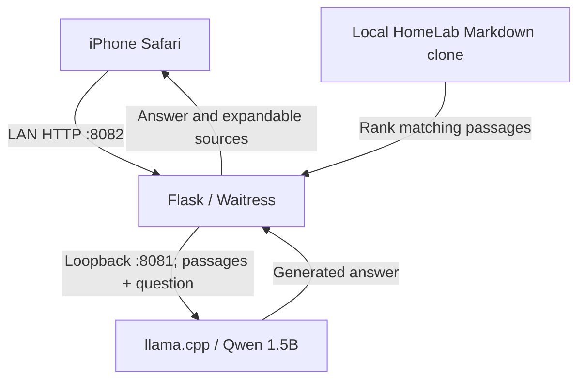

# Local AI Homelab Assistant

**Deployment verified:** October 29, 2026

**Scope:** Local inference and questions about repository documents. No live service checks or infrastructure control.

## Purpose and verified behavior

The existing 2014 Mac mini now hosts a small local LLM and a browser interface for asking questions about this HomeLab repository. This reuses its HDD and 8 GB RAM without adding inference load to the Dell Proxmox host. An iPhone can administer it through Termius and access the assistant through Safari on the home LAN.

The model generates answers locally. Flask and Waitress provide the web interface; they are not the LLM. After downloading the software, model, and documentation, answering questions does not require a cloud inference service. Git refreshes and software/model downloads still require network access.

| Component | Recorded configuration |
|---|---|
| Host | 2014 Mac mini; Intel x86_64; exact CPU model not recorded |
| Memory / storage | 8 GB RAM; approximately 1 TB HDD (931 GiB filesystem reported) |
| OS | macOS Monterey 12.7.6, build `21H1320` |
| Administration | macOS Remote Login / SSH; Termius on iPhone verified |
| Python | python.org Python 3.14.10; dedicated `.venv`; system Python 3.9.6 left intact |
| Compiler | Apple Clang 14.0.0, Command Line Tools |
| Inference engine | llama.cpp; server reported `0.8.0-dev`, build 1, commit `3c809f4` |
| Model | Official Qwen2.5-1.5B-Instruct GGUF, Q4_K_M; download approximately 1.12 GB |
| Inference settings | CPU only; 2 threads; 2,048-token context; one parallel slot |
| Model API | `http://127.0.0.1:8081`; loopback only |
| Frontend | Flask 3.1.3, Waitress 3.0.2, Requests 2.34.0 |
| User access | `http://<MAC_MINI_IP>:8082/`; listens on `0.0.0.0` |
| Supervision | System LaunchDaemons; processes run as the Mac account |
| Knowledge | Local Markdown clone of `HoseaCodes/HomeLab`; manual refresh |

Public examples use placeholders for the private LAN address and account. The app has no authentication or TLS. LAN access was verified; public exposure and off-LAN access were not configured. Treat access as suitable only for the intended trusted home network. Do not publish port `8082` through the existing public website tunnel.

## Request flow and retrieval



The assistant splits Markdown into overlapping windows of 14 lines, starting every 10 lines, capped at 1,000 characters per window. It ranks windows by shared query words with an inverse document-frequency weight and sends up to three passages to the model. Source labels contain the filename and starting line. Files are read again for each question.

This is a small retrieval-augmented generation implementation using lexical search. It does not train or fine-tune Qwen, create embeddings, or maintain a vector database. Each question is independent; conversation history is not retained by the application. Requests are limited to 500 question characters, with up to 220 generated tokens per response.

The prompt asks the model to use the passages, admit missing information, and cite filenames. Those instructions do not guarantee factual answers, complete answers, or consistent inline citations. Expand the retrieved passages and check claims before using an answer for operations. The assistant has no tools, service credentials, or command-execution path; an answer about deployment describes documents, not current availability.

## Files and deployment record

```text
~/homelab-assistant/
  .venv/
  assistant.py
  knowledge/                  # clone of this repository
  llama.cpp/                  # inference engine source and build/
  models/qwen-1.5b.gguf
  launchd/                    # generated plist staging files
  logs/                       # model and assistant stdout/stderr
```

Repository sources:

- [assistant.py](../services/local-ai/assistant.py) — deployed application, with the console URL sanitized for public sharing.
- [requirements.txt](../services/local-ai/requirements.txt) — directly installed versions observed during setup; not a complete dependency lock.
- [configure-launchd.py](../services/local-ai/configure-launchd.py) — generates the user-specific staging configuration used by this setup.

### Python, knowledge, and model build

These commands document a fresh setup. The working Mac already has these components; do not recreate or overwrite its environment just to refresh documentation. Run on the Mac mini through its Terminal or an SSH session connected to it. Install the python.org Python 3.14.10 package and Apple Command Line Tools first.

```bash
mkdir -p ~/homelab-assistant/models
/Library/Frameworks/Python.framework/Versions/3.14/bin/python3.14 -m venv ~/homelab-assistant/.venv

git clone --depth 1 https://github.com/HoseaCodes/HomeLab.git ~/homelab-assistant/knowledge
cp ~/homelab-assistant/knowledge/services/local-ai/assistant.py ~/homelab-assistant/assistant.py
~/homelab-assistant/.venv/bin/python -m pip install -r ~/homelab-assistant/knowledge/services/local-ai/requirements.txt
~/homelab-assistant/.venv/bin/python -m pip install cmake

git clone --depth 1 https://github.com/ggml-org/llama.cpp.git ~/homelab-assistant/llama.cpp
~/homelab-assistant/.venv/bin/cmake -S ~/homelab-assistant/llama.cpp -B ~/homelab-assistant/llama.cpp/build -DCMAKE_BUILD_TYPE=Release -DGGML_METAL=OFF -DLLAMA_BUILD_TESTS=OFF
~/homelab-assistant/.venv/bin/cmake --build ~/homelab-assistant/llama.cpp/build --config Release --target llama-server llama-cli -j2
~/homelab-assistant/llama.cpp/build/bin/llama-server --version
```

The original clone/build produced commit `3c809f4`. The clone command follows the upstream default branch, so a future rebuild can differ. Record the new commit and validate compatibility before replacing a working build. The CMake version and complete transitive dependency versions were not captured; this is a deployment record rather than a fully locked build.

```bash
curl --fail --location --retry 3 \
  https://huggingface.co/Qwen/Qwen2.5-1.5B-Instruct-GGUF/resolve/main/qwen2.5-1.5b-instruct-q4_k_m.gguf \
  --output ~/homelab-assistant/models/qwen-1.5b.gguf.part
```

Only after curl completes successfully:

```bash
mv ~/homelab-assistant/models/qwen-1.5b.gguf.part ~/homelab-assistant/models/qwen-1.5b.gguf
```

The model checksum was not recorded during the original deployment. Preserve the working model when experimenting with alternatives.

### Startup and headless operation

The installed jobs are `com.hosea.homelab.model` and `com.hosea.homelab.assistant`. Both use `RunAtLoad` and `KeepAlive`, with a 15-second throttle interval, the application working directory, and explicit paths to executables. The model binds to loopback; only the frontend binds to all interfaces. They are system jobs but run as the Mac account, not root.

Generate staging files **without sudo**, review them, and install only for a fresh deployment:

```bash
~/homelab-assistant/.venv/bin/python ~/homelab-assistant/knowledge/services/local-ai/configure-launchd.py
plutil -lint ~/homelab-assistant/launchd/*.plist
```

```bash
for name in model assistant; do
  label="com.hosea.homelab.$name"
  sudo install -o root -g wheel -m 644 \
    "$HOME/homelab-assistant/launchd/$label.plist" \
    "/Library/LaunchDaemons/$label.plist" &&
  sudo launchctl enable "system/$label" &&
  sudo launchctl bootstrap system "/Library/LaunchDaemons/$label.plist"
done
```

Already loaded jobs should be inspected/restarted using the operations commands below; `bootstrap` is not a restart command. Stop any manually launched copies before installing jobs to avoid port conflicts. Startup order is not coordinated: allow the model time to load before asking a question.

System sleep was disabled with `sudo pmset -a sleep 0`; `pmset -g custom` confirmed `sleep 0` and `displaysleep 10`. After reboot, the frontend and a fresh model answer worked without manually starting either process. This verifies automatic startup; a separate monitor-unplug test was not recorded.

FileVault was observed off, not disabled by this setup. Cold boot with FileVault enabled, automatic restart after power loss, UPS integration, and the Mac mini’s DHCP reservation were not tested or configured as part of this milestone. The captured power settings showed `autorestart 0`.

## Operations runbook

All terminal commands here run **on the Mac mini**—either in its local Terminal or inside the connected Termius session. A loopback URL in iPhone Safari refers to the phone, not the Mac.

### Check health and access

```bash
curl --max-time 10 http://127.0.0.1:8081/health
curl --max-time 10 -o /dev/null -w '%{http_code}\n' http://127.0.0.1:8082/
sudo launchctl print system/com.hosea.homelab.model
sudo launchctl print system/com.hosea.homelab.assistant
```

The deployment returned `{"status":"ok"}` and HTTP `200`. Open `http://<MAC_MINI_IP>:8082/` in Safari from the home LAN and ask a documentation question. Frontend HTTP `200` alone does not prove the model can answer.

### Refresh knowledge

```bash
git -C ~/homelab-assistant/knowledge pull --ff-only
```

No service restart is needed for Markdown changes. There is no scheduled sync. Pulling the repository does not deploy changes to the separately copied `~/homelab-assistant/assistant.py` or reload launchd configuration. Refresh the clone after publishing these documentation changes.

### Inspect logs and restart

```bash
tail -n 60 ~/homelab-assistant/logs/model.err.log
tail -n 60 ~/homelab-assistant/logs/assistant.err.log
sudo launchctl kickstart -k system/com.hosea.homelab.model
sudo launchctl kickstart -k system/com.hosea.homelab.assistant
```

Logs also include `model.out.log` and `assistant.out.log`. Log rotation has not been configured. A model restart interrupts an active request and requires loading time. For app updates, retain a copy of the working `assistant.py`, review/copy the replacement, restart only the assistant, and repeat a document-answer check. Rollback is restoring that saved file and restarting; a formal rollback drill has not been recorded.

### Common issues

| Symptom | Check or action |
|---|---|
| SSH repeats the password prompt | Use the Mac account’s short username and login password; verify Remote Login permits that account. Do not use the Apple ID password unless it happens to match. Never paste passwords into issue reports. |
| SSH copy from Downloads says `Operation not permitted` | This occurred during setup; Finder was used to copy the file into `~/homelab-assistant`. Do not assume Unix file permissions are the cause or grant broad remote disk access just for this copy. |
| Frontend opens but model cannot answer | Check model health and `model.err.log`; wait for loading, then retry. The app’s older error text may mention a Termius session even though launchd now supervises the model. |
| Model says a service is running | Check the cited document and actual monitoring separately; the assistant cannot verify live state. |
| Missing facts or wrong passages | Check the local clone is current; name the exact service/component. Small passage windows and the small model can omit information. |
| Works locally but not on the iPhone | Confirm the Mac is awake, both devices are on the intended LAN, and the current Mac address is used; check host/router access controls. |

## Validation and remaining work

Evidence is from the setup session and user-provided terminal/browser results, not an automated inspection of the Mac by this repository.

| Check | Observed result |
|---|---|
| SSH from iPhone | Successful session and hostname command |
| Local generation | Browser reply generated by Qwen 1.5B |
| Short-run speed | One 48-token reply reported 3.2 seconds / 14.83 generated tokens per second; not a sustained benchmark |
| Repository Q&A | Correctly identified Dell OptiPlex 3070, i5-9500, six cores, and 16 GB RAM; retrieved passages displayed |
| Reboot startup | Frontend and a fresh Social Ring question worked without manual service startup |
| Social Ring answer | Identified the dedicated Ubuntu Apps VM on the Dell Proxmox host; answer was brief and did not describe the full deployment flow |

Open work: broader grounded-answer evaluation, authentication/TLS if access expands, private remote access, Mac/AI availability monitoring, log rotation, dependency/build pinning and model checksums, backup/restore testing, and power-loss recovery. The current assistant is not an independent outage observer. Monitoring and command execution would be separate future integrations.

## References

- [llama.cpp source and build documentation](https://github.com/ggml-org/llama.cpp)
- [llama.cpp server documentation](https://github.com/ggml-org/llama.cpp/tree/master/tools/server)
- [Official Qwen2.5-1.5B-Instruct GGUF model](https://huggingface.co/Qwen/Qwen2.5-1.5B-Instruct-GGUF)
- [Apple launchd jobs documentation](https://developer.apple.com/library/archive/documentation/MacOSX/Conceptual/BPSystemStartup/Chapters/CreatingLaunchdJobs.html)
