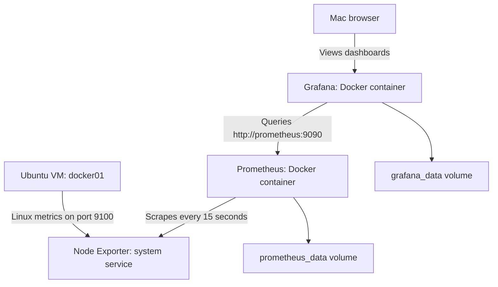

# Homelab Monitoring — Resource Metrics

**Recorded:** October 23, 2026  
**Status:** Ubuntu VM resource monitoring verified; service availability checks are next.

This milestone adds observability to the lab before deploying application workloads. The goal is to use measurements to understand resource use, investigate problems, and evaluate future backend services.

## Current scope

The monitored machine is `docker01`, an Ubuntu Server VM running on the Proxmox node `pve01`.

| Resource | Allocation |
|---|---|
| VM ID | 100 |
| CPU | 2 vCPU |
| Memory | 4 GiB |
| Virtual disk | 64 GiB |
| Network | VirtIO through Proxmox bridge `vmbr0`; router DHCP reservation |

The dashboard describes the Ubuntu guest. It does not measure the physical Dell's total resource usage or the household's total internet traffic, latency, or connection capacity.

## Components and data flow



| Component | Deployment | Purpose |
|---|---|---|
| Node Exporter | Ubuntu package `prometheus-node-exporter` | Exposes guest CPU, memory, filesystem, and network metrics |
| Prometheus | `prom/prometheus:latest` | Collects and stores time-series metrics |
| Grafana | `grafana/grafana:latest` | Queries Prometheus and displays dashboards |
| Node Exporter Full | Grafana dashboard ID `1860` | Provides the initial Linux resource dashboard |

Prometheus and Grafana share the user-defined Docker network `monitoring`. Grafana reaches Prometheus using its container name. Node Exporter runs directly in Ubuntu, so Prometheus reaches it using the VM's reserved LAN address.

## Completed configuration

- [x] Install Node Exporter and enable its service.
- [x] Confirm `systemctl is-active prometheus-node-exporter` returns `active`.
- [x] Create the Docker network `monitoring`.
- [x] Create persistent volumes `prometheus_data` and `grafana_data`.
- [x] Deploy Prometheus with the configuration below.
- [x] Verify both Prometheus targets report `UP`.
- [x] Deploy Grafana and complete login.
- [x] Add Prometheus as a Grafana data source.
- [x] Import Node Exporter Full and verify populated panels.

### Prometheus

Configuration on the VM: `~/monitoring/prometheus.yml`.

The example below is sanitized for public documentation. Replace `<VM_LAN_IP>` with the reserved address of `docker01` before using it.

```yaml
global:
  scrape_interval: 15s

scrape_configs:
  - job_name: prometheus
    static_configs:
      - targets: ['localhost:9090']

  - job_name: docker01
    static_configs:
      - targets: ['<VM_LAN_IP>:9100']
```

| Setting | Deployed value |
|---|---|
| Container name | `prometheus` |
| Restart policy | `unless-stopped` |
| Docker network | `monitoring` |
| Published port | VM LAN address, port `9090` |
| Configuration mount | `~/monitoring/prometheus.yml` → `/etc/prometheus/prometheus.yml`, read-only |
| Data mount | `prometheus_data` → `/prometheus` |
| Retention flags | `--storage.tsdb.retention.time=7d` and `--storage.tsdb.retention.size=1GB` |

Retention is limited by both age and size; the size threshold can shorten available history. These settings are not an exact cap on all storage used by Prometheus.

### Grafana

| Setting | Deployed value |
|---|---|
| Container name | `grafana` |
| Restart policy | `unless-stopped` |
| Docker network | `monitoring` |
| Published port | VM LAN address, port `3000` |
| Data mount | `grafana_data` → `/var/lib/grafana` |
| Data source name | `prometheus` |
| Prometheus server URL | `http://prometheus:9090` |
| Data source authentication | No authentication |
| Dashboard | Node Exporter Full, ID `1860` |
| Dashboard filters | Job `docker01`, nodename `docker01`, instance `<VM_LAN_IP>:9100` |

Recommended initial viewing settings are **Last 15 minutes** and **15s refresh**. The verification screenshot still showed **Last 24 hours** and **1m refresh**; changing these was recommended but has not yet been confirmed.

## Validation results

| Check | Observed result |
|---|---|
| Node Exporter service | `active` |
| Prometheus target `docker01` | `UP`, with a recent successful scrape |
| Prometheus self-monitoring target | `UP`, with a recent successful scrape |
| Grafana dashboard | Populated CPU, memory, disk, and network panels |
| Selected guest | `docker01` |

The initial target page showed `UNKNOWN` and `Last scrape: never`. After waiting and refreshing, both targets showed `UP`; no configuration change was needed.

The first populated dashboard showed:

| Metric | Reading |
|---|---:|
| CPU busy | 30.2% |
| RAM used | 25.1% of 4 GiB |
| Root filesystem used | 20.8% |
| Swap used | 0% |

These are observations from one screenshot, not an idle baseline or a capacity test. The dashboard had only a short collection history, so a 24-hour view compressed the available data against the right edge.

## Operational notes

Run administrative commands in the SSH session connected to `docker01`.

```bash
# Check the exporter.
systemctl is-active prometheus-node-exporter

# Check the monitoring containers.
sudo docker ps --filter name=prometheus --filter name=grafana

# Inspect recent logs when troubleshooting.
sudo docker logs --tail 100 prometheus
sudo docker logs --tail 100 grafana
```

Use the Prometheus `/targets` page to check collection status. For a failed target, expand its details and inspect the scrape error before changing settings. Check the exporter service, configured address, and network reachability as appropriate.

Grafana stores its settings and dashboards in `grafana_data`; Prometheus stores its metrics in `prometheus_data`. Volumes survive container recreation when reused, but they are not independent backups. The source configuration file also needs to be preserved.

The initial deployments used `latest` image tags. Exact image versions or digests were not recorded, so this document does not claim a fully reproducible version-pinned deployment. Record and pin the deployed images when moving this setup into version-controlled deployment manifests.

## Boundaries and next work

The existing recovery snapshots are `ubuntu-base` and `docker-portainer-ready`; both predate this monitoring work. A new monitoring snapshot or backup has not been confirmed.

All monitoring components currently run inside the same VM on one Proxmox host. A VM or host outage also stops these components, so this setup cannot independently report its own complete failure.

- [ ] Add service availability checks for Proxmox, Portainer, and Grafana.
- [ ] Test detection and recovery using a controlled service interruption.
- [ ] Configure and test an alert notification destination.
- [ ] Add physical Proxmox host metrics separately.
- [ ] Record a longer baseline before adding application workloads.
- [ ] Preserve deployment configuration, dashboards, and data through a tested backup process.
- [ ] Add an independent observer if monitoring whole-host outages becomes a requirement.

Service availability checks and alert delivery have **not** been configured in this milestone. Successful metric scrapes verify the exporter and Prometheus endpoints, not the availability of every lab service.

## References

- [Prometheus installation](https://prometheus.io/docs/prometheus/latest/installation/)
- [Prometheus configuration](https://prometheus.io/docs/prometheus/latest/configuration/configuration/)
- [Grafana Docker installation](https://grafana.com/docs/grafana/latest/setup-grafana/installation/docker/)
- [Grafana Prometheus data source](https://grafana.com/docs/grafana/latest/datasources/prometheus/configure/)
- [Node Exporter Full dashboard](https://grafana.com/grafana/dashboards/1860-node-exporter-full/)

Public examples omit private LAN addresses, MAC addresses, passwords, and tokens. Suggested repository location: `docs/monitoring.md`.
