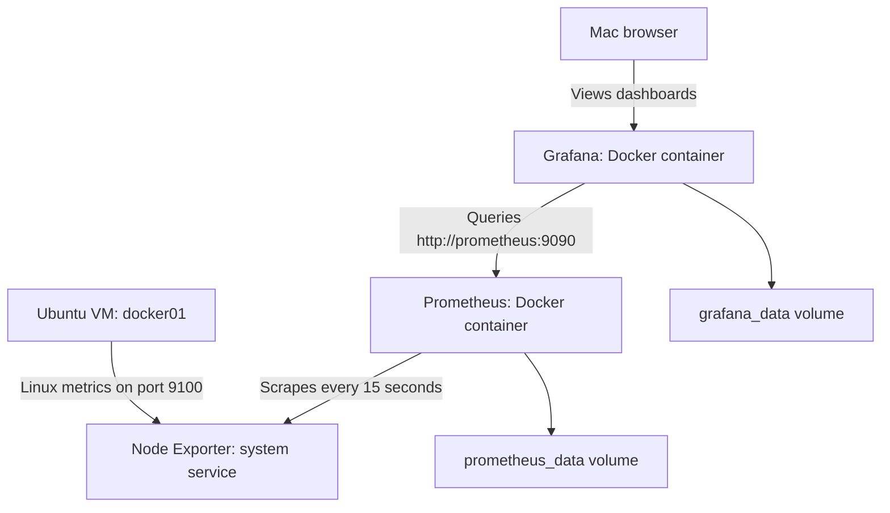

# Homelab Monitoring — Metrics, Availability, and Email Alerts

**Recorded:** October 23, 2026  
**Status:** Guest resource monitoring, three service availability checks, Gmail outage/recovery notifications, and the `monitoring-ready` snapshot are complete.

[Return to the project README](../README.md).

This milestone adds observability to the lab before deploying application workloads. The goal is to use measurements to understand resource use, investigate problems, and evaluate future backend services.

## Current scope

The monitored machine is `docker01`, an Ubuntu Server VM running on the Proxmox node `pve01`.

| Resource | Allocation |
|---|---|
| VM ID | 100 |
| CPU | 2 vCPU |
| Memory | 4 GiB |
| Virtual disk | 64 GiB |
| Network | VirtIO through Proxmox bridge `vmbr0`; router DHCP reservation |

The dashboard describes the Ubuntu guest. It does not measure the physical Dell's total resource usage or the household's total internet traffic, latency, or connection capacity.

## Components and data flow



| Component | Deployment | Purpose |
|---|---|---|
| Node Exporter | Ubuntu package `prometheus-node-exporter` | Exposes guest CPU, memory, filesystem, and network metrics |
| Prometheus | `prom/prometheus:latest` | Collects and stores time-series metrics |
| Grafana | `grafana/grafana:latest` | Queries Prometheus and displays dashboards |
| Node Exporter Full | Grafana dashboard ID `1860` | Provides the initial Linux resource dashboard |
| Uptime Kuma | `louislam/uptime-kuma:2`, SQLite | Checks service availability and sends Gmail notifications |

Prometheus, Grafana, and Uptime Kuma share the user-defined Docker network `monitoring`. Grafana reaches Prometheus using its container name. Node Exporter runs directly in Ubuntu, so Prometheus reaches it using the VM's reserved LAN address.

## Completed configuration

- [x] Install Node Exporter and enable its service.
- [x] Confirm `systemctl is-active prometheus-node-exporter` returns `active`.
- [x] Create the Docker network `monitoring`.
- [x] Create persistent volumes `prometheus_data` and `grafana_data`.
- [x] Deploy Prometheus with the configuration below.
- [x] Verify both Prometheus targets report `UP`.
- [x] Deploy Grafana and complete login.
- [x] Add Prometheus as a Grafana data source.
- [x] Import Node Exporter Full and verify populated panels.
- [x] Deploy Uptime Kuma and select SQLite.
- [x] Create three HTTP availability checks and verify all report UP.
- [x] Verify a controlled Grafana outage and recovery in Kuma.
- [x] Configure Gmail SMTP and confirm a test email.
- [x] Confirm DOWN and UP emails during a subsequent Grafana test.
- [x] Save the `monitoring-ready` snapshot without RAM.

### Prometheus

Configuration on the VM: `~/monitoring/prometheus.yml`.

The example below is sanitized for public documentation. Replace `<VM_LAN_IP>` with the reserved address of `docker01` before using it.

```yaml
global:
  scrape_interval: 15s

scrape_configs:
  - job_name: prometheus
    static_configs:
      - targets: ['localhost:9090']

  - job_name: docker01
    static_configs:
      - targets: ['<VM_LAN_IP>:9100']
```

| Setting | Deployed value |
|---|---|
| Container name | `prometheus` |
| Restart policy | `unless-stopped` |
| Docker network | `monitoring` |
| Published port | VM LAN address, port `9090` |
| Configuration mount | `~/monitoring/prometheus.yml` → `/etc/prometheus/prometheus.yml`, read-only |
| Data mount | `prometheus_data` → `/prometheus` |
| Retention flags | `--storage.tsdb.retention.time=7d` and `--storage.tsdb.retention.size=1GB` |

Retention is limited by both age and size; the size threshold can shorten available history. These settings are not an exact cap on all storage used by Prometheus.

### Grafana

| Setting | Deployed value |
|---|---|
| Container name | `grafana` |
| Restart policy | `unless-stopped` |
| Docker network | `monitoring` |
| Published port | VM LAN address, port `3000` |
| Data mount | `grafana_data` → `/var/lib/grafana` |
| Data source name | `prometheus` |
| Prometheus server URL | `http://prometheus:9090` |
| Data source authentication | No authentication |
| Dashboard | Node Exporter Full, ID `1860` |
| Dashboard filters | Job `docker01`, nodename `docker01`, instance `<VM_LAN_IP>:9100` |

Recommended initial viewing settings are **Last 15 minutes** and **15s refresh**. The verification screenshot still showed **Last 24 hours** and **1m refresh**; changing these was recommended but has not yet been confirmed.

## Validation results

| Check | Observed result |
|---|---|
| Node Exporter service | `active` |
| Prometheus target `docker01` | `UP`, with a recent successful scrape |
| Prometheus self-monitoring target | `UP`, with a recent successful scrape |
| Grafana dashboard | Populated CPU, memory, disk, and network panels |
| Selected guest | `docker01` |

The initial target page showed `UNKNOWN` and `Last scrape: never`. After waiting and refreshing, both targets showed `UP`; no configuration change was needed.

The first populated dashboard showed:

| Metric | Reading |
|---|---:|
| CPU busy | 30.2% |
| RAM used | 25.1% of 4 GiB |
| Root filesystem used | 20.8% |
| Swap used | 0% |

These are observations from one screenshot, not an idle baseline or a capacity test. The dashboard had only a short collection history, so a 24-hour view compressed the available data against the right edge.

## Service access

These templates are for devices on the lab LAN. Substitute the private addresses locally; no actual LAN addresses or credentials are included in this public document.

| Service | URL template |
|---|---|
| Uptime Kuma | `http://<VM_IP>:3001/dashboard` |
| Grafana | `http://<VM_IP>:3000/dashboards` |
| Prometheus targets | `http://<VM_IP>:9090/targets` |
| Portainer | `https://<VM_IP>:9443/` |
| Proxmox | `https://<PROXMOX_IP>:8006/` |

## Uptime Kuma and availability checks

| Setting | Deployed value |
|---|---|
| Container name | `uptime-kuma` |
| Image tag used | `louislam/uptime-kuma:2` |
| Restart policy | `unless-stopped` |
| Docker network | `monitoring` |
| Published port | VM LAN address, port `3001` |
| Data mount | `uptime_kuma_data` → `/app/data` |
| Database | SQLite |

The initial deployment command was equivalent to this sanitized example. Replace `<VM_IP>` before running; this is deployment documentation, not a command to rerun against an existing container.

```bash
sudo docker volume create uptime_kuma_data
sudo docker run -d \
  --name uptime-kuma \
  --restart unless-stopped \
  --network monitoring \
  -p <VM_IP>:3001:3001 \
  -v uptime_kuma_data:/app/data \
  louislam/uptime-kuma:2
```

All three monitors use HTTP(s), GET requests, a 60-second heartbeat interval, 2 retries, no HTTP authentication, and accepted status codes `200-299`. Retry interval was left at 60 seconds. Redirect handling remains at the default.

| Monitor | URL template | TLS setting | What it checks |
|---|---|---|---|
| Proxmox | `https://<PROXMOX_IP>:8006/` | Ignore TLS/SSL errors enabled for its self-signed certificate | Web login page responds |
| Portainer | `https://<VM_IP>:9443/` | Ignore TLS/SSL errors enabled for its self-signed certificate | Web interface responds |
| Grafana | `http://<VM_IP>:3000/api/health` | TLS exception not needed for HTTP | Health endpoint responds successfully |

Domain expiry notifications were disabled for the local IP targets. TLS exceptions apply to the two local HTTPS monitors, not to Gmail SMTP. These checks do not exercise authenticated administration or verify every function behind the login pages.

## Gmail notifications

Notification name: `Homelab Email Alerts`. Email is the current notification channel; an app notification channel is planned for later and has not been configured.

| Setting | Configured value |
|---|---|
| Provider | Email (SMTP) |
| Host | `smtp.gmail.com` |
| Port / security | `465`, SSL/TLS |
| SMTP username | Full Gmail address, kept private |
| SMTP password | Google app password, kept private |
| Sender | Same Gmail account |
| Recipient | Owner's chosen email address, kept private |
| SMTP certificate verification | Enabled |
| Monitor assignment | Proxmox, Portainer, and Grafana |

Google 2-Step Verification was required for the app password. The SMTP test message was received, followed by a successful real Grafana DOWN/UP email test. No passwords, app passwords, tokens, or recipient addresses belong in this repository.

## Controlled outage and recovery validation

The test stopped only the Grafana container while Kuma and Prometheus continued running. The recovery command was supplied before the test so Grafana could be restored even if an alert did not arrive.

```bash
# Run inside docker01 over SSH; intentionally interrupts Grafana.
sudo docker stop grafana

# After checking Kuma's DOWN state, restore Grafana.
sudo docker start grafana
```

The first recorded test on October 23, 2026 showed the following in the browser's local time (America/Chicago):

| Event | Time | Result |
|---|---|---|
| Grafana marked DOWN | 10:11:06 PM | Connection refused on port 3000 |
| Grafana marked UP | 10:14:06 PM | HTTP `200 - OK` |

These timestamps describe monitor state transitions, not exact container stop/start times or a measured detection delay. Proxmox and Portainer remained successful in the captured view. The lower uptime percentage during this short history included the intentional Grafana outage.

After Gmail configuration, a second controlled Grafana test confirmed both the outage and recovery emails. Exact timestamps for that second test were not recorded. Grafana was restored after testing.

## Operational notes

Run administrative commands in the SSH session connected to `docker01`.

```bash
# Check the exporter.
systemctl is-active prometheus-node-exporter

# Check the monitoring containers.
sudo docker ps --filter name=prometheus --filter name=grafana --filter name=uptime-kuma

# Inspect recent logs when troubleshooting.
sudo docker logs --tail 100 prometheus
sudo docker logs --tail 100 grafana
sudo docker logs --tail 100 uptime-kuma
```

Use the Prometheus `/targets` page to check collection status. For a failed target, expand its details and inspect the scrape error before changing settings. Check the exporter service, configured address, and network reachability as appropriate.

Grafana stores its settings and dashboards in `grafana_data`; Prometheus stores its metrics in `prometheus_data`. Volumes survive container recreation when reused, but they are not independent backups. Kuma stores its SQLite database, monitor settings, history, and notification settings in `uptime_kuma_data`. The source configuration file also needs to be preserved. Any future backup containing notification credentials must be kept private.

The initial Prometheus and Grafana deployments used `latest` image tags; Kuma used the moving major-version tag `2`. Exact image versions or digests were not recorded, so this document does not claim a fully reproducible version-pinned deployment. Record and pin the deployed images when moving this setup into version-controlled deployment manifests.

## Recovery checkpoints and deferred backups

| Snapshot | Recorded state |
|---|---|
| `ubuntu-base` | Updated Ubuntu, SSH, guest agent, DHCP reservation; before Docker |
| `docker-portainer-ready` | Docker verified and Portainer running; before monitoring |
| `monitoring-ready` | Metrics, availability checks, and tested Gmail notifications; RAM excluded |

The owner confirmed creation of `monitoring-ready` after the email outage/recovery test. A snapshot provides rollback on the current storage; it does not protect against loss of the Dell's SSD.

**Decision:** Independent VM backups and restore testing are deferred until a NAS is acquired. No NAS backup, independent backup, or restore drill is currently claimed as complete. When storage becomes available, configure a backup target and test recovery into an isolated VM.

## Boundaries and remaining work

All monitoring components run inside `docker01` on the same Proxmox host. A VM or host outage stops Kuma too. Gmail notifications also depend on outbound internet connectivity. Independent detection of a whole-host or household internet outage requires an observer outside that failure domain.

Kuma's HTTP checks report endpoint availability. Prometheus and Grafana describe guest resources. Resource threshold alerts, per-container resource metrics, and physical host resource metrics have not been configured in this milestone.

- [x] Add service availability checks for Proxmox, Portainer, and Grafana.
- [x] Test detection and recovery using a controlled service interruption.
- [x] Configure Gmail and verify outage and recovery emails.
- [x] Create the `monitoring-ready` rollback snapshot.
- [ ] Add an app notification channel later.
- [ ] Add physical Proxmox host resource metrics separately.
- [ ] Record a longer baseline before adding application workloads.
- [ ] Record and pin container image versions or digests.
- [ ] Back up configuration, dashboards, volumes, and the VM after NAS acquisition.
- [ ] Test restoring the backup into an isolated environment.
- [ ] Add an independent observer if whole-host outage detection is needed.

## References

- [Prometheus installation](https://prometheus.io/docs/prometheus/latest/installation/)
- [Prometheus configuration](https://prometheus.io/docs/prometheus/latest/configuration/configuration/)
- [Grafana Docker installation](https://grafana.com/docs/grafana/latest/setup-grafana/installation/docker/)
- [Grafana Prometheus data source](https://grafana.com/docs/grafana/latest/datasources/prometheus/configure/)
- [Node Exporter Full dashboard](https://grafana.com/grafana/dashboards/1860-node-exporter-full/)

- [Uptime Kuma project](https://github.com/louislam/uptime-kuma)
- [Google app passwords](https://support.google.com/accounts/answer/185833)

Public examples omit private LAN addresses, MAC addresses, passwords, and tokens. Repository location: `docs/monitoring.md`.
