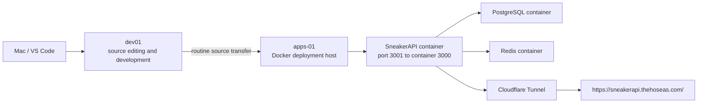

# SneakerAPI Deployment

**Recorded:** November 18, 2026

**Status:** Docker containers and a public Cloudflare hostname have been configured. Database authentication, Prisma migration, `/api/releases`, and public endpoint verification remain incomplete.

## Architecture



## Verified deployment facts

- Development source: `/home/dominique/projects/sneakerapi` on `dev01`.
- Deployment directory: `/home/dominique/deployments/sneakerapi` on `apps-01`.
- Application runtime: Fastify, TypeScript, and Prisma.
- Docker Compose services: `sneakerapi`, `postgres`, and `redis`.
- SneakerAPI container: `sneakerapi-sneakerapi-1`.
- PostgreSQL container: `sneakerapi-postgres-1`.
- Redis container: `sneakerapi-redis-1`.
- Docker image and container rebuild state were observed after source transfer.
- Host publication: `192.168.0.47:3001:3000`.
- Container application port: `3000`.
- App health endpoint: `/api/health`.
- Public hostname: `https://sneakerapi.thehoseas.com/`.
- Public access was reported configured through the existing Cloudflare infrastructure.
- Docker administration on `apps-01` uses `sudo` for this deployment.

## Confirmed operating state

- The SneakerAPI container started and logged that it listens on `0.0.0.0:3000`.
- Docker publishes port `3001` on `192.168.0.47` to port `3000` in the container.
- `postgres` and `redis` were observed running; PostgreSQL was healthy.
- `/api/health` was observed responding locally with HTTP `200` and an `status: ok` payload.
- The public URL was reported hosted on November 18, 2026.

## Known incomplete state

- `/api/releases` returned HTTP `500` instead of the expected successful response.
- Prisma migration deployment is blocked by PostgreSQL authentication that does not match the container role/password configuration.
- Direct PostgreSQL role and database verification was attempted, but the database credentials and owner state require another successful test.
- Public `/api/health` and `/api/releases` responses still need live verification through `https://sneakerapi.thehoseas.com/`.
- A Docker health check mismatch remains in the application source: the Dockerfile checks `/health`, while the application route is `/api/health`.
- Automatic deployment, application monitoring, database backup/restore, and rollback testing are not confirmed.
- The Docker Compose `version` attribute is obsolete and should be removed in a future source cleanup.

## Operations runbook

### Transfer source

Routine transfers should exclude `node_modules`, `.git`, and `.env`:

```bash
cd ~/projects/sneakerapi

tar --exclude=node_modules --exclude=.git --exclude=.env \
  -czf - -C ~/projects/sneakerapi . \
  | ssh dominique@192.168.0.47 \
  "mkdir -p ~/deployments/sneakerapi && tar -xzf - -C ~/deployments/sneakerapi"
```

Keep production secrets in the deployment env file on `apps-01`, with restricted permissions. Do not commit or document `.env` values.

### Compose status

```bash
cd ~/deployments/sneakerapi
sudo docker compose --env-file .env ps
sudo docker compose --env-file .env logs --tail 100 sneakerapi
sudo docker compose --env-file .env logs --tail 100 postgres
sudo docker compose --env-file .env logs --tail 100 redis
```

### Local health checks

```bash
curl -i http://192.168.0.47:3001/api/health
curl -i http://192.168.0.47:3001/api/releases
```

A successful health response proves only that Fastify is serving. `/api/releases` additionally proves that the route can authenticate and query PostgreSQL.

### Public health checks

```bash
curl -i https://sneakerapi.thehoseas.com/api/health
curl -i https://sneakerapi.thehoseas.com/api/releases
```

Record public HTTP status and response behavior before describing the public API as fully verified.

### Container rebuild

A source update or image change requires a rebuild; a rebuild does not update a running container automatically.

```bash
cd ~/deployments/sneakerapi
sudo docker compose --env-file .env build sneakerapi
sudo docker compose --env-file .env up -d --force-recreate sneakerapi
```

Changing `.env` also requires container recreation:

```bash
sudo docker compose --env-file .env up -d --force-recreate sneakerapi
```

### Stop and start

```bash
sudo docker compose --env-file .env stop sneakerapi
sudo docker compose --env-file .env start sneakerapi
sudo docker compose --env-file .env restart sneakerapi
```

### Database troubleshooting

Run Prisma with the Compose env file:

```bash
cd ~/deployments/sneakerapi
sudo docker compose --env-file .env run --rm sneakerapi npx prisma migrate deploy
```

Prisma authentication errors require checking that all of these agree:

- `POSTGRES_USER`
- `POSTGRES_PASSWORD`
- `POSTGRES_DB`
- `DATABASE_URL`
- `SHADOW_DATABASE_URL`
- the PostgreSQL role and owner state in the existing volume

Never change credentials by guessing. Test direct PostgreSQL connectivity and record only success/failure, not password values.

Useful direct checks:

```bash
sudo docker compose --env-file .env exec postgres env | grep '^POSTGRES_'
sudo docker compose --env-file .env exec -T postgres psql -U sneakerapi -d sneakerapi -c "SELECT 1;"
```

### Rollback

Preserve the previous image before replacing it:

```bash
sudo docker tag sneakerapi-sneakerapi:local sneakerapi-sneakerapi:previous
```

The exact Compose image name and previous-tag behavior should be verified before this is used. Rollback execution is currently untested.

### Backup and recovery boundaries

- PostgreSQL data lives in a Docker volume; deleting or recreating only the container does not necessarily delete it.
- Deleting the PostgreSQL volume destroys its database data.
- Redis data and PostgreSQL data require separate backup processes.
- Existing `dev01` project archives do not provide PostgreSQL recovery or apps-01 system recovery.
- Database backup, restore, migration verification, rollback testing, and application monitoring remain pending.

## Security follow-up

- Remove old external-provider credentials and comments from local/source env files after their providers are retired.
- Use a strong unique PostgreSQL password consistently across Compose initialization and Prisma URLs.
- Keep production secrets outside Git and this documentation.
- Correct the Docker health check to `/api/health` when updating the source.
- Remove obsolete Compose `version` declarations if the source is updated.
