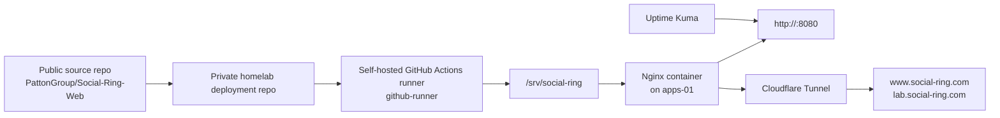

# Social Ring Deployment Guide

**Recorded:** October 25, 2026  
**Status:** Public static hosting is deployed and verified locally. Some public-facing behaviors remain pending verification, including redirect and clean-URL enforcement.

This document covers the deployed Social Ring static website running on the dedicated Apps VM. It is intentionally scoped to the current live deployment and distinguishes verified behavior from planned work.

## Purpose

The purpose of this deployment is to host an existing static website on the home lab without depending on a hosted SaaS provider. The site source lives in a public Git repository, while the deployment process uses a private repository for automation and a self-hosted GitHub Actions runner on the lab.

This is a static-site deployment, not a full application stack. Backend builds, database migrations, and Kubernetes remain future work.

## Architecture



## VM and hosting layout

| Resource | Value |
|---|---|
| VM ID | `101` |
| Hostname | `apps-01` |
| Guest OS | Ubuntu Server 24.04.5 LTS |
| vCPU | 2 |
| RAM | 2 GiB |
| Virtual disk | 32 GiB |
| Hypervisor | Proxmox node `pve01` |
| Application path | `/srv/social-ring` |
| Local service URL | `http://<APPS_VM_IP>:8080` |
| Public access | Cloudflare Tunnel with HTTPS |
| Runtime | Nginx serving static HTML/CSS/JavaScript |
| Portainer connection | Portainer Agent connected to the same Portainer instance as `docker01` |

The site is served as static files and does not require a backend web framework or database. This keeps the deployment small, easy to audit, and aligned with the current lab’s single-host design.

## Delivery workflow

The delivery path is:

1. A push to the public source repository updates the project source.
2. A private GitHub repository contains the deployment workflow for the home lab.
3. The self-hosted runner on `apps-01` receives the trigger and downloads the deployment payload.
4. The runner updates the files in `/srv/social-ring`.
5. Nginx serves the updated content from the new files.
6. Uptime Kuma checks the local endpoint and the site is exposed through Cloudflare Tunnel.

The runner is configured as `github-runner` and has access to the website directory, but it does not have sudo privileges and does not have Docker access. That keeps the deployment workflow constrained to the files it must update.

## Permissions and security model

The automation model intentionally limits what the runner can do:

- The runner can update the website files in `/srv/social-ring`.
- The runner does not have sudo access.
- The runner does not have Docker access.
- The system is not designed to deploy arbitrary infrastructure changes from the workflow.
- The static site content is intentionally simple enough to recover with a small controlled rollback.

This makes the deployment narrow in scope and easier to reason about without exposing the full host to the automation workflow.

## Cloudflare and HTTPS

The site is exposed through Cloudflare Tunnel using the public hostnames:

- `https://lab.social-ring.com`
- `https://www.social-ring.com`

The lab uses this public path without router port forwarding. This is a valid current state for the deployment, but the following items remain pending verification and are intentionally marked as not confirmed:

- Root-domain redirect and canonical host behavior.
- Always Use HTTPS enforcement.
- Clean URLs without `.html` suffixes.
- Public HTTPS monitor via Uptime Kuma or a similar check.

## Operations

### Deploy the site

The deployment process is intentionally limited to the website asset directory. Use the workflow or the runner’s deployment script to publish the updated files into `/srv/social-ring`.

### Inspect the local endpoint

```bash
curl -I http://<APPS_VM_IP>:8080
```

A healthy response is the simplest proof that the content is being served locally. Uptime Kuma verifies this check before the site is treated as stable.

### Inspect the site content on the VM

```bash
ls -l /srv/social-ring
find /srv/social-ring -maxdepth 2 -type f | sort | head
```

### Inspect the Nginx container or config

```bash
sudo docker ps
sudo docker logs --tail 100 nginx
```

Replace the command names with the actual live names if the service is reconfigured. This file is intentionally a sanitized guide rather than a literal command log from the live environment.

### Troubleshoot the deployment

Use this sequence when the site is unavailable:

1. Confirm the local HTTP endpoint responds.
2. Check the Nginx container and its logs.
3. Confirm the runner published files into `/srv/social-ring`.
4. Confirm Cloudflare Tunnel is running on the Apps VM.
5. Check the GitHub workflow run logs for the deployment status.
6. Re-check the Uptime Kuma monitor if it reported a state change.

### Restore the previous website

The current design supports a simple rollback by restoring the previous files in `/srv/social-ring` and reloading the Nginx service. The workflow or runner can be pointed back to a known-good build.

This rollback path was provided, but execution and recovery testing were not explicitly confirmed in the current public documentation.

## Sanitized example configuration

The following examples are intentionally marked as examples pending comparison with the live VM. They are not claimed to match the site exactly.

### services/social-ring/compose.yaml

```yaml
# Example only; compare against the live Apps VM before treating as authoritative.
services:
  social-ring:
    image: nginx:stable-alpine
    container_name: social-ring
    restart: unless-stopped
    ports:
      - "<APPS_VM_IP>:8080:80"
    volumes:
      - /srv/social-ring:/usr/share/nginx/html:ro
    networks:
      - social-ring-net

networks:
  social-ring-net:
    driver: bridge
```

### services/social-ring/nginx.conf

```nginx
# Example only; compare against the live Apps VM before treating as authoritative.
server {
    listen 80;
    server_name _;

    root /usr/share/nginx/html;
    index index.html;

    location / {
        try_files $uri $uri/ =404;
    }
}
```

## Recovery design

The current deployment has the following limits and constraints:

- One physical host: `pve01` is a single point of failure.
- Home power and internet dependency remain real operational risks.
- Independent backups remain deferred.
- The site is not covered by a full restore drill to an isolated environment yet.
- No full infrastructure-as-code pinning is claimed for the live VM.

## Remaining work

The following items remain intentionally listed as pending or planned because they were not explicitly confirmed:

- Root-domain redirect behavior.
- `Always Use HTTPS` configuration.
- Clean URLs without `.html` suffixes.
- Public HTTPS monitor for the live site.
- A verified rollback test against the live environment.
- Independent backup and isolated restore drill.
- Broader static-site automation improvements, such as version-pin management and single-source-runbook documentation.

## Summary

The Social Ring deployment is a valid public-serving milestone for the lab: a dedicated Apps VM, static content delivery, local monitoring, private deployment automation, and Cloudflare Tunnel access have been verified in the current scope. The deployment remains intentionally honest about what is not yet proven, especially the public redirect, HTTPS policy, and recovery drill.
